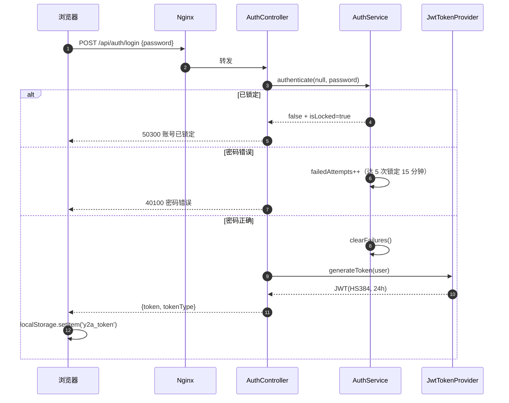
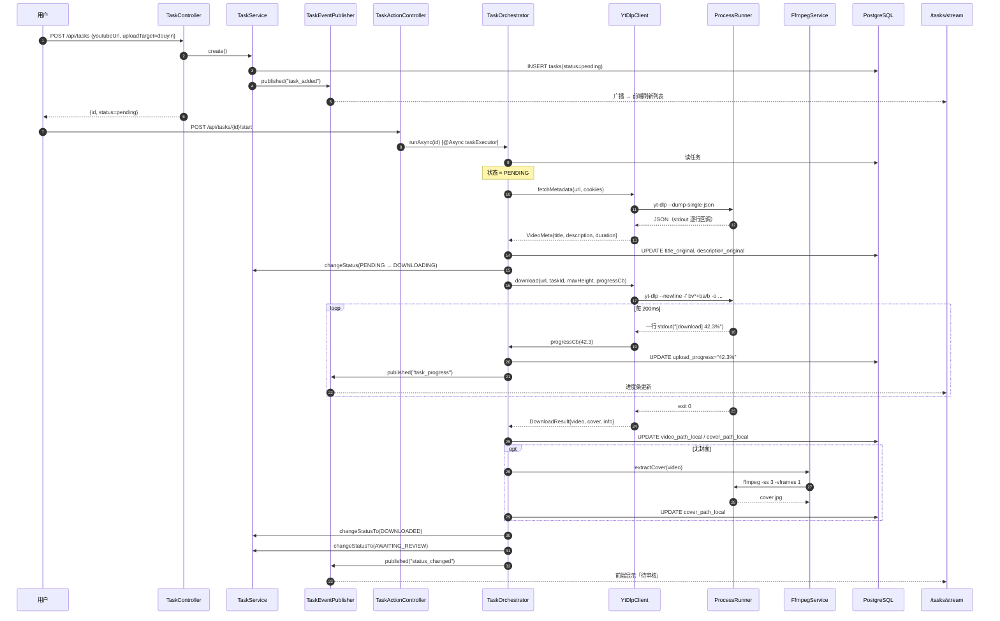
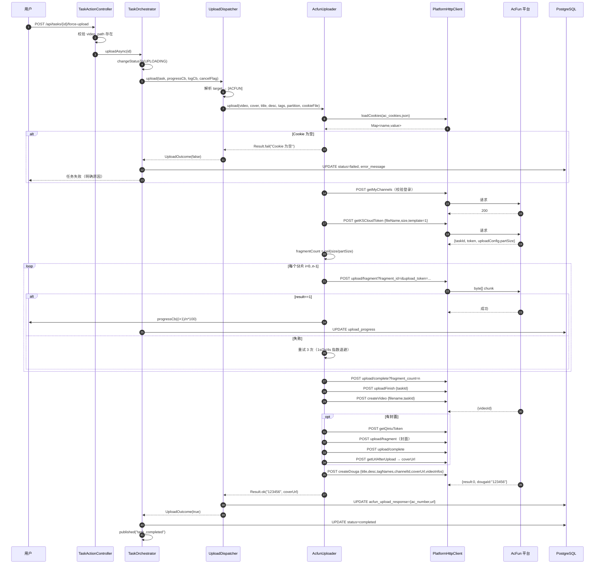
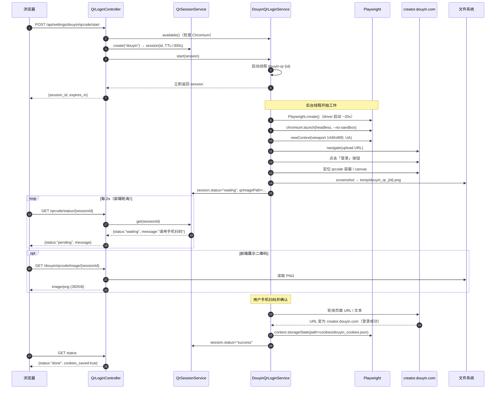
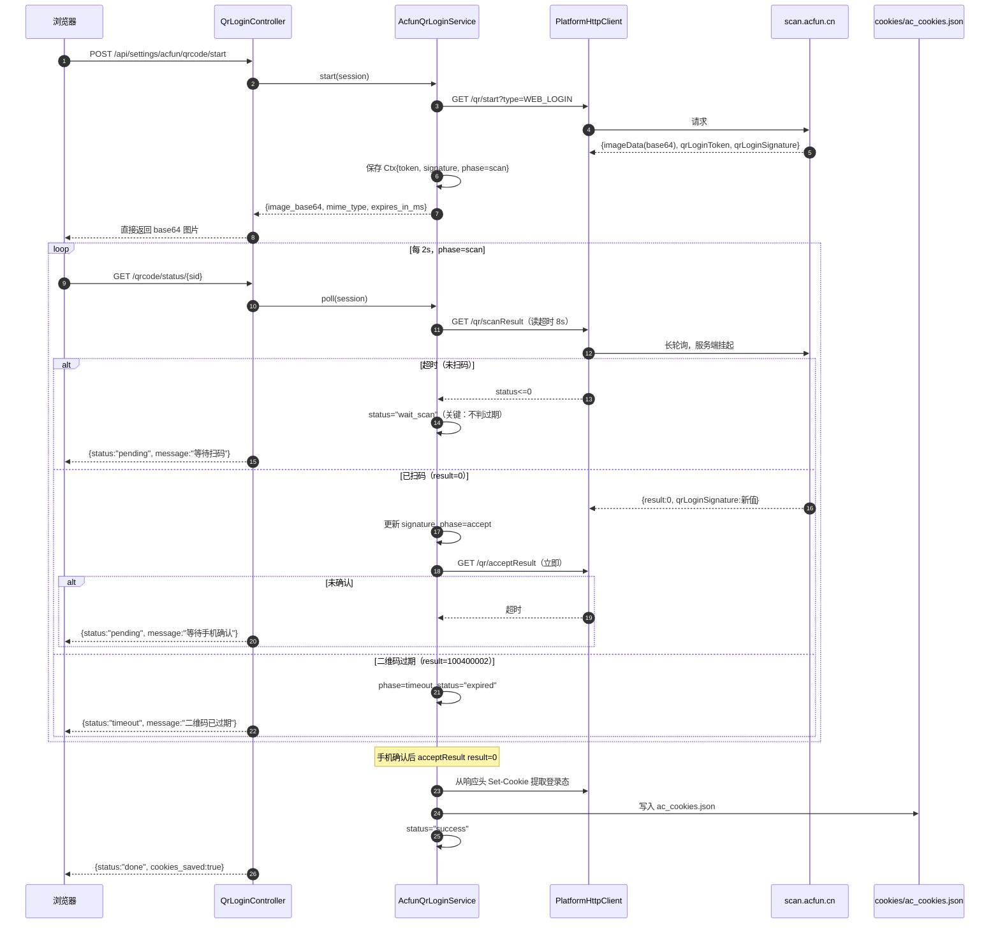
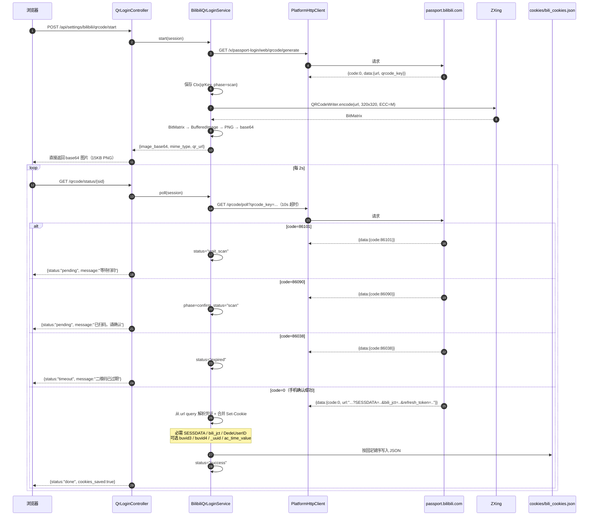
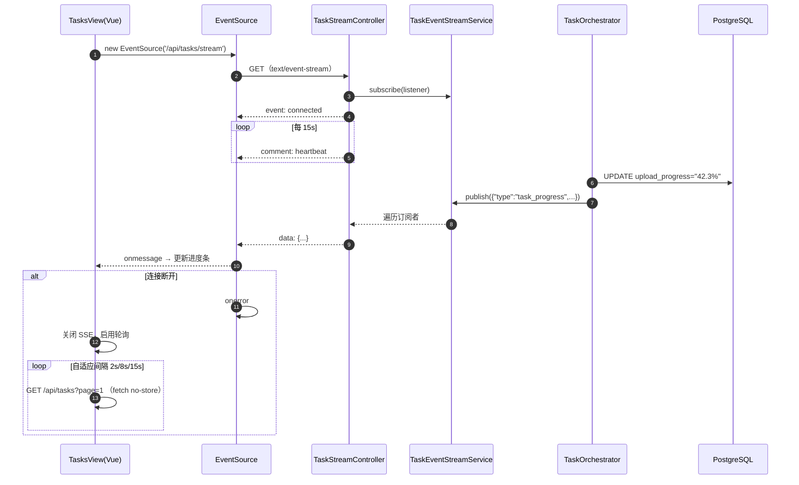
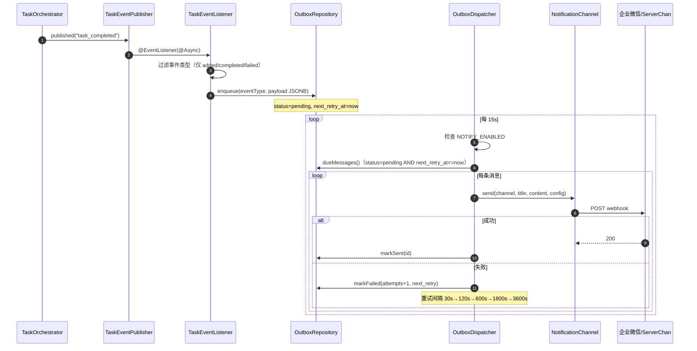

# Y2A-Auto Java 重构 · 架构文档

> **版本**：v1.0　**日期**：2026-11-22
> **对应代码**：`y2a-java/`（Spring Boot 3.3 + Java 21）
> **阅读对象**：开发、运维、后续接手者

---

## 目录

1. [系统定位与设计原则](#1-系统定位与设计原则)
2. [总体架构](#2-总体架构)
3. [技术栈与选型理由](#3-技术栈与选型理由)
4. [代码结构与分层](#4-代码结构与分层)
5. [数据模型](#5-数据模型)
6. [核心机制](#6-核心机制)
7. [关键时序图](#7-关键时序图)
8. [外部依赖与集成](#8-外部依赖与集成)
9. [部署架构](#9-部署架构)
10. [扩展指南](#10-扩展指南)

---

## 1. 系统定位与设计原则

### 1.1 定位

把 YouTube 视频自动搬运到 **AcFun / bilibili / 抖音** 的一体化工具。全流程：
下载 → ASR → 字幕翻译 → 转码烧录 → 内容审核 → 平台投稿。

### 1.2 五条设计原则

| 原则 | 落地方式 |
| --- | --- |
| **纯 Java 业务逻辑** | Python 依赖降级为外部二进制（yt-dlp/ffmpeg）或由 Playwright Java 替代 |
| **状态机集中管控** | 15 个状态用枚举 + 迁移表，禁止散落的 status 赋值 |
| **策略模式解耦** | 上传器、通知渠道、配置归一化规则均用策略注册表，新增不改主流程 |
| **事件驱动** | 任务变更 → 领域事件 → SSE 广播 + 通知 outbox，服务间零耦合 |
| **前端零感知** | 1:1 复用原版 CSS/Bootstrap/DOM 结构，仅用 Vue 做数据绑定 |

---

## 2. 总体架构

### 2.1 架构全景

```
┌──────────────────────────────────────────────────────────────────────┐
│                         浏览器（Vue 3 + TS）                          │
│  /  /tasks  /manual_review  /tasks/:id/edit  /youtube_monitor  /settings │
│  复用原版: style.css · bootstrap 5.1.3 · bootstrap-icons 1.13.1        │
└───────────────────────────────┬──────────────────────────────────────┘
                                │ HTTP(S) + SSE
                     ┌──────────▼───────────┐
                     │   Nginx (y2a-web)    │  静态资源 + /api 反代
                     └──────────┬───────────┘
                                │
┌───────────────────────────────▼──────────────────────────────────────┐
│                     Spring Boot 3.3 (y2a-java)                        │
│                                                                       │
│  ┌─────────────────────────────────────────────────────────────────┐ │
│  │  接入层  Controller × 12                                        │ │
│  │  Auth · Task · TaskAction · TaskStream(SSE) · Dashboard ·       │ │
│  │  Config · Settings · QrLogin · Monitor · System · EngineCallback│ │
│  └────────────────────────┬────────────────────────────────────────┘ │
│                           │                                           │
│  ┌────────────────────────▼────────────────────────────────────────┐ │
│  │  应用服务层  Service × 12                                       │ │
│  │  TaskService(状态机) · TaskOrchestrator(流水线) ·                │ │
│  │  ConfigService · DashboardService · MonitorService ·             │ │
│  │  AuthService · CookieService · QrSessionService ·                │ │
│  │  AcfunQrLoginService · DouyinQrLoginService ·                    │ │
│  │  EngineCallbackService · TaskEventStreamService                  │ │
│  └───────┬──────────────────────────────────┬──────────────────────┘ │
│          │                                  │                         │
│  ┌───────▼──────────────┐        ┌──────────▼──────────────────────┐ │
│  │  上传层 uploader     │        │  工具层 tools                   │ │
│  │  UploadDispatcher    │        │  ProcessRunner(进程执行器)      │ │
│  │  ├ AcfunUploader     │        │  YtDlpClient(下载/元信息/字幕)  │ │
│  │  ├ BilibiliUploader  │        │  FfmpegService(转码/烧录/抽帧)  │ │
│  │  │  └ WbiSigner      │        │  PlatformHttpClient(Cookie/请求)│ │
│  │  └ DouyinPublisher   │        │  ToolPaths(路径/自检)           │ │
│  └──────────────────────┘        └─────────────────────────────────┘ │
│                                                                       │
│  ┌──────────────────────────────────────────────────────────────────┐ │
│  │  数据层  Repository × 6 (MyBatis-Plus)                           │ │
│  │  Task · Config · MonitorConfig · MonitorHistory · Outbox ·Dash   │ │
│  └────────────────────────┬─────────────────────────────────────────┘ │
│                           │                                           │
│  ┌────────────────────────▼─────────────────────────────────────────┐ │
│  │  基础设施  common/                                               │ │
│  │  Security(JWT) · Exception · Constant(枚举) · Config(MyBatis/Async)│ │
│  └──────────────────────────────────────────────────────────────────┘ │
└───────────────────────────────┬──────────────────────────────────────┘
                                │ JDBC
                    ┌───────────▼────────────┐
                    │  PostgreSQL 16 (y2a-pg)│
                    │  13 张表 · 208 配置项  │
                    └────────────────────────┘

        ┌─────────────────────── 外部二进制 ───────────────────────┐
        │  yt-dlp 2026.10.26  ·  ffmpeg/ffprobe 8.0.1             │
        │  Chromium 1148 (Playwright)                             │
        └─────────────────────────────────────────────────────────┘
        ┌─────────────────────── 外部平台 ─────────────────────────┐
        │  YouTube · AcFun · bilibili · 抖音 · OpenAI(待接)        │
        └─────────────────────────────────────────────────────────┘
```

### 2.2 分层职责

| 层 | 职责 | 约束 |
| --- | --- | --- |
| Controller | 参数校验、DTO 转换、调用 Service、包装 ApiResponse | **不含业务逻辑** |
| Service | 业务编排、事务边界、领域规则 | 通过接口依赖 Repository / tools |
| Repository | 数据访问，MyBatis-Plus BaseMapper + @Select | 不写业务判断 |
| Domain | 实体 + 领域行为（充血模型） | Task.statusEnum() 等 |
| tools | 外部系统封装（进程/HTTP/文件） | 无 Spring 事务 |
| uploader | 平台协议实现 | 只依赖 PlatformHttpClient |

---

## 3. 技术栈与选型理由

| 层 | 选型 | 理由 |
| --- | --- | --- |
| 框架 | Spring Boot 3.3.5 / Java 21 | LTS、虚拟线程就绪、生态成熟 |
| 持久层 | MyBatis-Plus 3.5.7 | 复杂 SQL 可控；BaseMapper 免写 CRUD；分页插件成熟 |
| 数据库 | PostgreSQL 16 | JSONB 存配置/响应；并发优于 SQLite |
| 迁移 | Flyway 10 | 版本化 SQL，与 Java 生态一致 |
| 鉴权 | Spring Security 6 + JJWT 0.12 | 无状态 JWT，去掉 Flask session |
| HTTP 客户端 | Java 11 HttpClient（平台请求）+ WebClient（引擎） | 零额外依赖；WebClient 适合异步 |
| 浏览器自动化 | Playwright Java 1.49 + driver-bundle | 官方支持，与 Python 版同源算法 |
| 二维码渲染 | ZXing 3.5.3（core） | bilibili 扫码需把 URL 渲染成 PNG，替代 Python `qrcode` |
| 前端 | Vue 3.5 + Vite 6 + TypeScript 5.7 + Pinia | 轻量、类型安全；**不引入 UI 库**以保持原版样式 |
| 构建 | Maven 3.9 多模块 + 多阶段 Dockerfile | 标准、可缓存 |

### 3.1 为什么不用 JPA

配置表 208 行 JSONB、任务表 39 列且查询以动态条件为主，MyBatis-Plus 的 `@Select` 长 SQL 比 Criteria API 更直观，也便于对照 Python 原生 SQL 迁移。

### 3.2 为什么前端不用 Element Plus

原版是 Bootstrap 5 + 自定义 CSS。用 UI 库重写会**必然产生视觉差异**。当前方案是：原版 `style.css`（1140 行）+ 模板内联样式抽取（`legacy-inline.css` 331 行）直接复用，Vue 只做数据绑定与组件划分，因此像素级一致。

---

## 4. 代码结构与分层

### 4.1 包结构（68 个文件 / 6546 行）

```
com.y2a.server
├── Y2aApplication.java                    @SpringBootApplication + @MapperScan
│
├── common/                                基础设施
│   ├── config/       AsyncConfig(线程池) · MybatisPlusConfig(分页/自动填充)
│   ├── constant/     TaskStatus(15状态机) · UploadTarget(4平台) · PipelineStage(8阶段)
│   ├── exception/    ApiResponse · BizException · ErrorCode · GlobalExceptionHandler
│   └── security/     SecurityConfig · JwtTokenProvider · JwtAuthenticationFilter
│
├── controller/                            12 个接入端点类
│   ├── AuthController            /api/auth/{login,logout,me}
│   ├── TaskController            /api/tasks CRUD
│   ├── TaskActionController      /api/tasks/{id}/{start,force-upload,retry,abandon,delete}
│   │                             + /clear_all /retry_failed /reset_stuck /manual_review
│   ├── TaskStreamController      /api/tasks/stream (SSE)
│   ├── DashboardController       /api/dashboard
│   ├── ConfigController          /api/config
│   ├── SettingsController        Cookie上传/通知测试/维护清理
│   ├── QrLoginController         /api/settings/{platform}/qrcode/*
│   ├── MonitorController         /api/monitor/*
│   ├── SystemController          /api/system/health
│   ├── ToolsDiagnosticsController /api/system/tools
│   └── EngineCallbackController  /api/internal/engine/callback
│
├── service/                               应用服务
│   ├── TaskService               状态机 + CRUD + 批量运维
│   ├── TaskOrchestrator          流水线编排（下载/字幕/转码/上传）
│   ├── ConfigService             208 配置 + 归一化策略表
│   ├── DashboardService          9 项统计 + upload_id 解析
│   ├── MonitorService            监控 CRUD + 异步运行 + 配额
│   ├── AuthService               密码校验 + 失败锁定
│   ├── CookieService             Cookie 上传/路径解析/状态检查
│   ├── QrSessionService          扫码会话（TTL 420/300/300）
│   ├── AcfunQrLoginService       AcFun 扫码（纯 HTTP 长轮询）
│   ├── BilibiliQrLoginService    bilibili 扫码（纯 HTTP + ZXing 渲染）
│   ├── DouyinQrLoginService      抖音扫码（Playwright）
│   ├── EngineCallbackService     引擎回调阶段分派
│   ├── TaskEventStreamService    SSE 订阅广播
│   └── notification/             策略模式
│       ├── NotificationChannel(接口) · NotificationDispatcher(注册表)
│       ├── WecomChannel · ServerchanChannel · MessagePusherChannel
│       └── OutboxDispatcher(定时投递 + 递增重试)
│
├── domain/                                领域模型
│   ├── task/Task                 39 字段实体 + 领域行为
│   ├── config/AppConfigEntry     JSONB 配置项
│   └── monitor/{MonitorConfig,MonitorHistory}
│
├── repository/                            数据访问（6 个）
│   ├── TaskRepository            search(动态条件分页)
│   ├── ConfigRepository · DashboardRepository
│   ├── MonitorConfigRepository · MonitorHistoryRepository
│   └── OutboxRepository
│
├── uploader/                              平台协议
│   ├── UploadDispatcher          策略分发 + 幂等跳过
│   ├── AcfunUploader             6 步投稿链路
│   ├── DouyinPublisher           Playwright 发布
│   └── bili/{BilibiliUploader, WbiSigner}
│
├── tools/                                 外部系统封装
│   ├── ProcessRunner            进程执行（流式/超时/取消）
│   ├── ToolPaths                路径配置 + 可用性探测
│   ├── YtDlpClient              元信息/下载/字幕 + 进度解析
│   ├── FfmpegService            ffprobe/转码/烧录/抽帧
│   └── PlatformHttpClient       Cookie解析/表单/JSON/二进制/multipart
│
└── engine/                                引擎集成（Phase 4 预留）
    ├── EngineClient             提交阶段任务 + 健康探测
    └── dto/{EngineTaskRequest, EngineCallback}
```

### 4.2 前端结构（9 组件 / 1743 行）

```
y2a-web/
├── public/                     原版静态资源（1:1 拷贝）
│   ├── css/style.css           1140 行原版样式
│   ├── css/legacy-inline.css   331 行（从模板抽取的内联样式）
│   ├── js/main.js              原版 CSRF guard + 表单补全
│   ├── lib/bootstrap/          Bootstrap 5.1.3
│   ├── lib/icons/              Bootstrap Icons 1.13.1 + 字体
│   ├── img/ · fonts/           图标与字幕字体
├── src/
│   ├── main.ts                 createApp + pinia + router
│   ├── App.vue                 复刻 base.html（顶栏/flash/footer/通知弹窗）+ router-view
│   ├── api/index.ts            Axios + JWT 拦截 + 401 跳转 + ApiResponse 解包
│   ├── api/task.ts             任务 API 封装
│   ├── router/index.ts         10 条路由 + 守卫
│   ├── stores/{auth,task}.ts   Pinia
│   ├── types/task.ts           TS 类型 + 状态文案表
│   └── views/                  9 个页面
│       ├── LoginView.vue       密码单字段 + login-fullscreen
│       ├── IndexView.vue       仪表盘
│       ├── TasksView.vue       表格/卡片双渲染 + SSE
│       ├── ManualReviewView.vue
│       ├── EditTaskView.vue
│       ├── MonitorView.vue · MonitorConfigView.vue · MonitorHistoryView.vue
│       └── SettingsView.vue    9 tab + 上传 + 扫码
```

---

## 5. 数据模型

### 5.1 ER 概览

```
                    ┌─────────────────┐
                    │    app_config   │  208 项，JSONB 值
                    │ PK config_key   │
                    │    category     │
                    └─────────────────┘

┌──────────────────────────┐         ┌──────────────────────────┐
│          tasks           │         │    monitor_configs       │
│ PK id (UUID text)        │         │ PK id (bigserial)        │
│    youtube_url           │         │    name / enabled         │
│    upload_target         │◄───┐    │    monitor_type           │
│    status (15 状态)      │    │    │    channel_mode           │
│    video_title_*         │    │    │    keywords / schedule_*  │
│    tags_generated JSONB  │    │    └────────┬─────────────────┘
│    *_partition_id_*      │    │             │ 1:N
│    video_path_local      │    │    ┌────────▼─────────────────┐
│    cover_path_local      │    │    │    monitor_history        │
│    subtitle_*            │    │    │ PK id                     │
│    pipeline_checkpoint   │    │    │ FK config_id             │
│    upload_progress       │    │    │ UQ (config_id, video_id) │
│    {acfun,bili,douyin}_  │    │    │    added_to_tasks         │
│      upload_response     │    │    └──────────────────────────┘
│      JSONB               │    │
└──────────────────────────┘    │    ┌──────────────────────────┐
                                │    │      monitor_run_claim   │
                                │    │ PK config_id (运行互斥)  │
                                │    └──────────────────────────┘
                                │
                  任务结果写回   │    ┌──────────────────────────┐
                                └────│   notification_outbox    │
                                     │ PK id                    │
                                     │    event_type / payload  │
                                     │    status / attempts     │
                                     │    next_retry_at         │
                                     └──────────────────────────┘
```

### 5.2 tasks 表关键字段

| 字段 | 类型 | 说明 |
| --- | --- | --- |
| `id` | TEXT PK | UUID |
| `upload_target` | TEXT | `acfun` / `bilibili` / `douyin` / `both` |
| `status` | TEXT | 15 状态之一（见 6.1） |
| `tags_generated` | JSONB | 标签数组 |
| `pipeline_checkpoint` | JSONB | 已完成阶段列表（断点续跑） |
| `video_path_local` / `cover_path_local` | TEXT | 下载产物绝对路径 |
| `subtitle_path_original` / `_translated` | TEXT | 字幕路径 |
| `{platform}_upload_response` | JSONB | 平台返回（ac_number / bvid / item_id + url） |
| `moderation_result` | JSONB | 审核结果 |
| `upload_progress` | TEXT | 进度文本（"42.5%"） |

### 5.3 配置分类（208 项）

| 分类 | 示例键 | 数量级 |
| --- | --- | --- |
| `security` | password_protection_enabled, LOGIN_MAX_FAILED_ATTEMPTS | ~10 |
| `account` | *_COOKIES_PATH, YOUTUBE_PROXY_* | ~20 |
| `ai` | OPENAI_*, FALLBACK_*, SUBTITLE_QC_* | ~30 |
| `subtitle_asr` | WHISPER_*, VOXTRAL_*, VAD_*, SUBTITLE_* | ~90 |
| `media` | VIDEO_ENCODER, VIDEO_CPU_*, FFMPEG_* | ~20 |
| `moderation` | CONTENT_MODERATION_*, ALIYUN_* | ~8 |
| `notification` | NOTIFY_* | ~20 |
| `ops` | MAX_CONCURRENT_*, LOG_CLEANUP_* | ~10 |

---

## 6. 核心机制

### 6.1 任务状态机

```
                    ┌──────────────────────────────┐
                    │           PENDING            │
                    └──┬────┬────┬────┬────┬───────┘
          ┌────────────┘    │    │    │    └────────────┐
          ▼                 ▼    ▼    ▼                 ▼
    DOWNLOADING        TRANSLATING TAGGING PARTITIONING MODERATING
          │                 │    │    │    │              │
          ▼                 └────┴────┴────┴──────────────┤
     DOWNLOADED ◄──┐                                    ▼
          │        │                          AWAITING_REVIEW ◄────┐
          ├────────┴──────────┐                     │              │
          ▼                   ▼                     ▼              │
  ASR_TRANSCRIBING  TRANSLATING_SUBTITLE      READY_FOR_UPLOAD     │
          │                   │                     │              │
          └───────┬───────────┘                     ▼              │
                  ▼                              UPLOADING ─────────┘
            ENCODING_VIDEO                            │
                  │                        ┌──────────┴──────────┐
                  └────────────────────────►                    ▼
                                      COMPLETED            FAILED
                                                              │
                                                              ▼
                                                          PENDING (重试)
```

**规则**：迁移合法性由 `TaskStatus.TRANSITIONS` 集中定义，非法迁移抛 `BizException(INVALID_STATE)`。
**特例**：运维动作（force-upload）走 `changeStatusTo()` 跳过常规校验。

### 6.2 流水线编排

`TaskOrchestrator.run(taskId)` 按当前状态决定从哪一步继续：

```
读取任务状态
  ├─ PENDING      → fetchInfo() → download() → [字幕] → [转码] → AWAITING_REVIEW
  ├─ DOWNLOADING  → download()  → ...
  ├─ DOWNLOADED   → [字幕] → [转码] → AWAITING_REVIEW
  ├─ ENCODING_VIDEO → [转码] → AWAITING_REVIEW
  └─ 其它         → 直接进入待审核
```
每步结束都回写任务字段并 `eventPublisher.published()`，前端通过 SSE 感知。

### 6.3 上传分发（策略模式）

```java
UploadTarget target = task.targetEnum();
for (UploadTarget p : target.platforms()) {          // BOTH → [ACFUN, BILIBILI]
    if (alreadyUploaded(task, p)) continue;          // 幂等跳过
    switch (p) {
        case ACFUN    -> uploadAcfun(...);           // 6 步 HTTP
        case BILIBILI -> uploadBilibili(...);        // UPOS + WBI
        case DOUYIN   -> uploadDouyin(...);          // Playwright
    }
    task = reload(task);                             // 取回含响应的最新实体
}
```

**幂等性**：每个平台成功后立即写 `{platform}_upload_response`，重跑时跳过。

### 6.4 SSE 实时推送

```
Service ──publish(event)──► TaskEventPublisher (Spring ApplicationEvent)
                                    │
                            TaskEventListener (@Async)
                              ├──► TaskEventStreamService.publish(json)
                              │         └─► 所有 SseEmitter 订阅者
                              └──► OutboxRepository.enqueue()  （通知类事件）
```

前端 `EventSource('/api/tasks/stream')` 接收；断连后降级为轮询（2s/8s/15s 自适应）。

### 6.5 配置归一化（策略注册表）

```java
normalizers.put("UPLOAD_TARGET_DEFAULT", v -> UploadTarget.fromValue(str(v)).value());
// Phase 4 继续注册：
//   BILIBILI_SUBMIT_API / VIDEO_QUALITY_MODE / *_REASONING_EFFORT / 颜色格式 ...
```
新增规则只注册，不改 `updateAll()` 主流程。

### 6.6 进程执行器

`ProcessRunner.run(cmd, options)` 统一封装：
- stdout/stderr 双线程泵 + 逐行回调（进度解析用）
- 200ms 轮询检查 `cancelFlag` 与超时
- 超时/取消 → `destroyForcibly()` + 5s 等待
- 内存保护：每流最多保留 2000 行

---

## 7. 关键时序图

### 7.1 用户登录



### 7.2 创建任务并跑完整流水线（下载阶段）



### 7.3 上传到平台（以 AcFun 为例）



### 7.4 抖音扫码登录



### 7.5 AcFun 扫码登录（长轮询）



### 7.6 bilibili 扫码登录（三态码）



**关键设计点**：
- **二维码渲染用 ZXing**（原版是 Python `qrcode` 库）——同属 QR 标准实现，输出等价
- **三态码映射**：`86101→等待扫码`、`86090→已扫待确认`、`86038→过期`、`0→成功`
- **凭证双来源合并**：成功时 URL query 与 Set-Cookie 都可能有 Cookie，取并集并保证必需键齐全
- **键序固定**：写入 JSON 时按 `SESSDATA, bili_jct, DedeUserID, buvid3, buvid4, _uuid, ac_time_value` 排序，与 Python 版一致，便于上传器读取

### 7.7 SSE 任务进度推送与降级



### 7.8 通知 outbox 异步投递



---

## 8. 外部依赖与集成

### 8.1 外部二进制

| 工具 | 版本 | 用途 | 调用方式 |
| --- | --- | --- | --- |
| yt-dlp | 2026.10.26 | 元信息 / 下载 / 字幕 | `ProcessRunner`（PyInstaller 单文件） |
| ffmpeg | 8.0.1 | 转码 / 字幕烧录 / 抽帧 | `ProcessRunner` |
| ffprobe | 8.0.1 | 媒体信息探测 | `ProcessRunner` |
| Chromium | 1148 | 抖音扫码 / 发布 | Playwright Java（driver-bundle） |

### 8.2 外部平台 API

| 平台 | 端点 | 鉴权 | 状态 |
| --- | --- | --- | --- |
| AcFun 上传 | `member.acfun.cn/video/api/*`、`upload.kuaishouzt.com` | Cookie | 🟡 待验证 |
| AcFun 扫码 | `scan.acfun.cn/rest/pc-direct/qr/*` | 无（返回 Cookie） | ✅ 实测 |
| bilibili 上传 | `member.bilibili.com/preupload`、`/x/vu/web/add/v3` | Cookie + WBI | 🟡 待验证 |
| bilibili 登录 | `api.bilibili.com/x/web-interface/nav` | Cookie | ✅ 校验可用 |
| bilibili 扫码 | `passport.bilibili.com/x/passport-login/web/qrcode/*` | 无（返回 Cookie） | ✅ 实测出码 |
| 抖音 | `creator.douyin.com`（Playwright） | storage_state | ✅ 扫码实测 |
| YouTube | yt-dlp 内置 extractor | Cookie（可选） | ✅ 实测 |

### 8.3 待接入

| 服务 | 用途 | 计划 |
| --- | --- | --- |
| OpenAI 兼容 API | 翻译 / 标签 / 分区 / 字幕质检 | Phase 4（openai-java） |
| Whisper / Voxtral | ASR | Phase 4 |
| 阿里云 Green | 内容审核 | Phase 5 |
| 阿里云 OSS | 存储（可选） | Phase 5 |
| CookieCloud | Cookie 同步 | Phase 5 |

---

## 9. 部署架构

### 9.1 容器编排

```yaml
services:
  postgres:   postgres:16-alpine       # 5432, volume pgdata
  server:     y2a-java-server          # 18080→8080, volume ./storage
  web:        nginx:alpine             # 5173→80, 挂载 dist + nginx.conf
```

### 9.2 镜像分层（server）

```dockerfile
FROM eclipse-temurin:21-jre
  ├─ apt: ffmpeg, fonts-noto-cjk, fontconfig, python3
  ├─ curl yt-dlp_linux → /usr/local/bin/yt-dlp
  ├─ COPY app.jar
  ├─ apt: libnss3, libgbm1, libasound2t64 ...（Chromium 依赖）
  ├─ PropertiesLauncher install chromium → /ms-playwright（863MB）
  └─ USER y2a
ENV PLAYWRIGHT_BROWSERS_PATH=/ms-playwright
    PLAYWRIGHT_SKIP_BROWSER_DOWNLOAD=1        # 关键：避免运行时联网
    Y2A_YTDLP_PATH / Y2A_FFMPEG_PATH / Y2A_FFPROBE_PATH
```

### 9.3 存储卷

| 路径 | 内容 |
| --- | --- |
| `./storage/downloads/<taskId>/` | 视频 / 封面 / 元数据 JSON |
| `./storage/cookies/` | yt_cookies.txt, ac_cookies.json, bili_cookies.json, douyin_cookies.json |
| `./storage/logs/douyin/` | 抖音失败截图 |
| `./storage/temp/` | 二维码截图 |

### 9.4 配置项（环境变量）

| 变量 | 默认 | 说明 |
| --- | --- | --- |
| `DB_URL` | `jdbc:postgresql://postgres:5432/y2a` | 数据库 |
| `JWT_SECRET` | dev 占位 | **生产必改** |
| `INITIAL_PASSWORD` | `admin` | 首次登录密码 |
| `Y2A_PLAYWRIGHT_ENABLED` | `true` | 无 Chromium 环境置 false |
| `ENGINE_BASE_URL` | `http://localhost:8001` | Phase 4 引擎地址 |

---

## 10. 扩展指南

### 10.1 新增一个投稿平台

1. 实现上传器：`uploader/XxxUploader.java`（参考 `AcfunUploader`）
   - 依赖注入 `PlatformHttpClient`
   - 返回 `Result(success, itemId, error)`
2. 加枚举：`UploadTarget` 增加 `XXX("xxx","XXX")`
3. 分发器：`UploadDispatcher.upload()` 加 `case XXX ->`
4. 数据库：`V4__add_xxx.sql` 加 `xxx_upload_response JSONB`
5. 实体：`Task` 加字段 + `update_task` 白名单
6. 前端：`TasksView` 平台徽标 + 上传结果分支
7. 测试：状态机 + 分发器单元测试

### 10.2 新增一个流水线阶段

1. `PipelineStage` 枚举加值 + `ORDER` 列表插入位置
2. `TaskOrchestrator.run()` 加阶段调用
3. `TaskStatus` 加对应状态 + 迁移边
4. 进度回写：`updateProgress()` + 事件发布
5. 前端：状态文案表 `STATUS_LABELS` 加映射

### 10.3 新增配置项

**不要手改 V2**。新增：`V{n}__config_xxx.sql`
```sql
INSERT INTO app_config (config_key, config_value, category)
VALUES ('NEW_KEY', '"default"'::jsonb, 'general')
ON CONFLICT (config_key) DO NOTHING;
```
若有归一化规则，在 `ConfigService.registerNormalizers()` 注册。

### 10.4 接入 Phase 4 引擎

已有预留：
- `EngineClient.submit(stage, taskId, payload)` → POST `/engine/tasks` + `callbackUrl`
- `EngineCallbackController` 接收引擎回调
- `EngineCallbackService` 按 stage 分派结果写入

接入步骤：
1. 启动 Python FastAPI 引擎（复用 `Y2A-Auto/modules/`）
2. 配置 `ENGINE_BASE_URL`
3. `TaskOrchestrator` 中把本地实现替换为 `engineClient.submit("asr", ...)`
4. 引擎完成后回调 → `EngineCallbackService` 更新任务

---

## 附录 A：关键类速查

| 类 | 职责 | 关键方法 |
| --- | --- | --- |
| `TaskStatus` | 15 状态机 | `canTransitionTo()` / `fromValue()` |
| `TaskService` | 任务 CRUD + 状态迁移 | `changeStatus()` / `resetStuck()` |
| `TaskOrchestrator` | 流水线编排 | `runAsync()` / `upload()` |
| `UploadDispatcher` | 平台分发 | `upload()` |
| `ProcessRunner` | 进程执行 | `run(cmd, options)` |
| `YtDlpClient` | 下载封装 | `fetchMetadata()` / `download()` |
| `FfmpegService` | 转码封装 | `transcode()` / `probe()` |
| `PlatformHttpClient` | 平台请求 | `loadCookies()` / `postForm()` / `postBytes()` |
| `QrSessionService` | 扫码会话 | `create()` / `get()` / `update()` |
| `ConfigService` | 208 配置 | `getAll()` / `updateAll()` |

## 附录 B：错误码

| 码 | 含义 | HTTP |
| --- | --- | --- |
| 0 | 成功 | 200 |
| 40000 | 参数错误 | 400 |
| 40100 | 未登录/密码错误 | 401 |
| 40300 | 无权限 | 403 |
| 40400 | 资源不存在 | 404 |
| 40900 | 状态冲突 | 409 |
| 50000 | 内部错误 | 500 |
| 50100 | 引擎不可用 | 503 |
| 50200 | 任务状态不允许该操作 | 400 |
| 50300 | 登录失败次数过多已锁定 | 401 |
